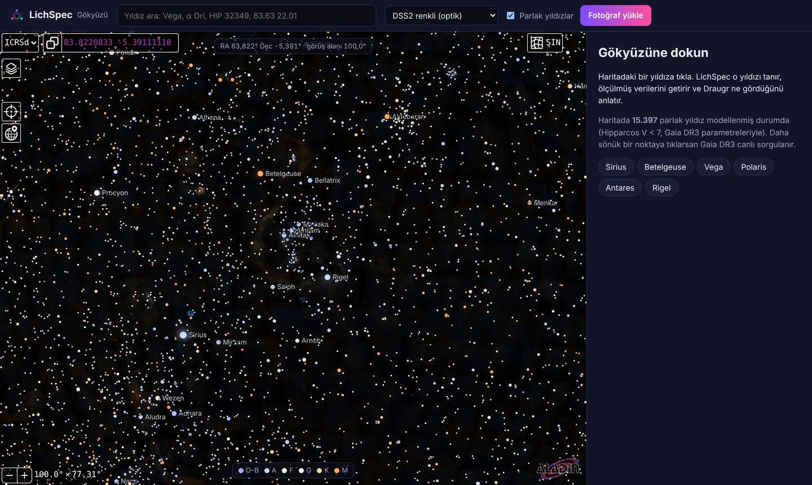

<p align="center">
  
</p>

<h1 align="center">LichSpec</h1>

<p align="center">
  AI system that identifies stars in space images (Phobetor), infers their composition from spectra (Poltergeist), and explains the results (Draugr).
</p>

<p align="center">
  <b><a href="https://ufuksagcan927-star.github.io/LichSpec/">Live sky explorer</a></b> ·
  <a href="web/README.md">Türkçe ayrıntılar</a> ·
  <a href="LICENSE">MIT licence</a>
</p>

---

## The sky explorer

A browser app for the whole sky as you would see it from where you stand: look around, click any star and
get a card built from its measured data, or drop in a night photo from your phone and see which stars and
constellations are in it.

| | |
|---|---|
|  |  |
| **From the ground.** The sky as it looks from where you stand right now: horizon, compass points, constellation figures with Turkish names. 15,504 stars modelled offline with Gaia DR3 parameters and proper names: every Hipparcos star brighter than V 7, plus well-known fainter ones (Proxima Centauri, Barnard's Star, Wolf 359, TRAPPIST-1); clickable and searchable by name, typos included. | **All 1.8 billion Gaia DR3 stars.** Zoom in and the brightest stars of the visible field stream in; the card shows temperature, gravity, chemistry, FLAME mass/age, radial velocity. |
|  |  |
| **Star card.** Every value names its source. Draugr (template version) narrates only what was measured; Poltergeist (preview) turns [M/H] into H/He/metal mass fractions. | **Photo → stars.** Night photos (JPG/PNG): Phobetor finds the stars in the browser and the star pattern is matched to the sky; star names and constellation figures are drawn on the photo (shown: the synthetic stacked-camera test photo). FITS images with a WCS header are solved too (matches astropy to 1e-10″). |

### How it works

- **One view, from the ground.** The sky is drawn the way a camera sees it from where you stand (gnomonic projection: straight lines stay straight and the horizon is always a straight line, up to a 120° field of view), with the observer's horizon, ground and compass points worked out for their place and time, and the constellation figures with Turkish names (`web/js/sky.js`). Dragging turns the view in altitude and azimuth, the way you turn your head, so it never flips at the zenith or the nadir. The ground is see-through (30% by default) so the sky below the horizon still shows; the "Yer" slider sets how much it covers, from clear to opaque. A star that is below the horizon right now is shown through the ground, with a note when it never rises from the observer's latitude.
- **Search** (`web/js/search.js`) runs offline over every star and constellation name: proper and Turkish names (`Kutup Yıldızı`, `Avcı`), Bayer letters in Greek or spelled out (`α Cen`, `Alfa Erboğa`), Flamsteed numbers, HIP, HD, Gliese and Gaia DR3 ids, with one or two typos forgiven (`proxima centuri`, `betelguese`). A star below the horizon is shown with the ground hidden.
- **Sky imagery** streams as HiPS tiles through [Aladin Lite v3](https://aladin.cds.unistra.fr/AladinLite/): Axel Mellinger's all-sky photograph when zoomed out, DSS2 fading in as you zoom; nothing is embedded in the site.
- **Gaia DR3** comes straight from the browser: CDS's Gaia HiPS catalogue when it answers, otherwise one "brightest 3,000 in this field" query to a VizieR mirror (CDS, Harvard CfA or IDIA, whichever answers first). Field size on that path is capped by galactic latitude, because the query scans every star in the circle.
- **Phobetor in the browser.** The star detector trained on Euclid Q1 is exported to ONNX without PyTorch (`tools/export_phobetor_onnx.py`, checked against an independent numpy forward pass) and runs in the visitor's browser with onnxruntime-web, on WebGPU when available, otherwise WebAssembly (`web/js/phobetor.js`). Stars so bright that their core is clipped at 255 are measured from the clipped core (Phobetor never saw such stars in Euclid images). Nothing is uploaded anywhere.
- **Blind star-pattern matching** (`web/js/solve.js`, in a Web Worker): unknown focal length is searched (EXIF first, including the sensor size for cameras that do not write the 35 mm focal length), triangles of the brightest stars are matched by angular distance against the bright-star catalogue, a fourth star must fit, each candidate is verified against the whole image (false-match probability < 1e-9), then attitude, focal length, lens distortion and optical centre are fitted to all matched stars. Aircraft and satellite trails and other straight lines are kept out of the triangles.
- **Measured.** All seven synthetic test photos (main camera, 3x tele, 100° ultrawide, city sky with only 13 stars, trailed stars, heavy noise reduction, a stacked camera photo with clipped stars) are solved to within 0.03°. Of 11 freely licensed real night photos from Wikimedia Commons, 8 are solved (fields from 16° to 73°); in those, 129 of the 147 stars brighter than V 3.5 inside the frame are found and named, most misses being low on the horizon or behind the foreground. The 3 that are not solved: a side-by-side composite, and two photos in which house and street lights are brighter than the stars (cutting the lights away solved one of them). Details in [web/README.md](web/README.md).
- **No server needed.** The site is static files (`web/`). An optional Flask server (`server/app.py`) adds a Gaia TAP proxy with ESA → Heidelberg failover and an Astrometry.net fallback for photos the browser cannot solve.
- **FITS/WCS in JavaScript** (`web/js/fits.js`): TAN and SIN projections, CD / PC / CDELT+CROTA matrices, gzip, BSCALE/BZERO, asinh preview stretch.
- **Tested on the real internet.** [`site-check`](.github/workflows/site-check.yml) probes every data service (DNS, CORS, latency, column names), then opens the static site in Playwright and checks the sky, the Gaia layer, a star card and a FITS solve. [`photo_check.js`](tools/photo_check.js) then uploads the synthetic test photos and the real photos from Wikimedia Commons (downloaded only for the test, never committed) and checks that each lands at the right place on the sky.

### Run it

```bash
cd web && python -m http.server 8080          # static, same as the hosted site
# or, with the optional server:
pip install -r server/requirements.txt && python server/app.py   # http://localhost:8000
```

Deployment: GitHub Pages (`.github/workflows/pages.yml`, Settings → Pages → Source: GitHub Actions) or Netlify (`netlify.toml`, publish folder `web`).

## The models

The name comes from the pulsar **Lich (PSR B1257+12)**, the first star found to host planets. Its three planets name the models:

| Model | Role | Status |
|---|---|---|
| **Phobetor** | Detects, segments and identifies stars in space images | Euclid mode trained (test precision 0.90, recall 0.76); runs in the browser on uploaded photos. A phone-photo fine-tune would help faint stars |
| **Poltergeist** | Predicts elements and compounds from a source's spectrum | Preview in the star card ([M/H] → composition, expected lines labelled "not measured") |
| **Draugr** | Explains the findings in plain language | Template narration from measured fields; LLM version planned |

## Data and credits

Gaia data © ESA/Gaia/DPAC (CC BY-SA 3.0 IGO); the Hipparcos Catalogue (ESA 1997) and its new reduction (van Leeuwen 2007); star names, constellation figures and boundaries from d3-celestial (BSD-3-Clause; figures after the IAU and Sky & Telescope charts); Aladin Lite, VizieR and HiPS by CDS, Strasbourg. Details and full notices: [THIRD_PARTY_NOTICES.md](THIRD_PARTY_NOTICES.md).

## Licence

Code: [MIT](LICENSE). The bundled star catalogue (`web/data/bright_stars.json`) contains Gaia DR3 values and is shared under CC BY-SA 3.0 IGO, as described in [THIRD_PARTY_NOTICES.md](THIRD_PARTY_NOTICES.md).
