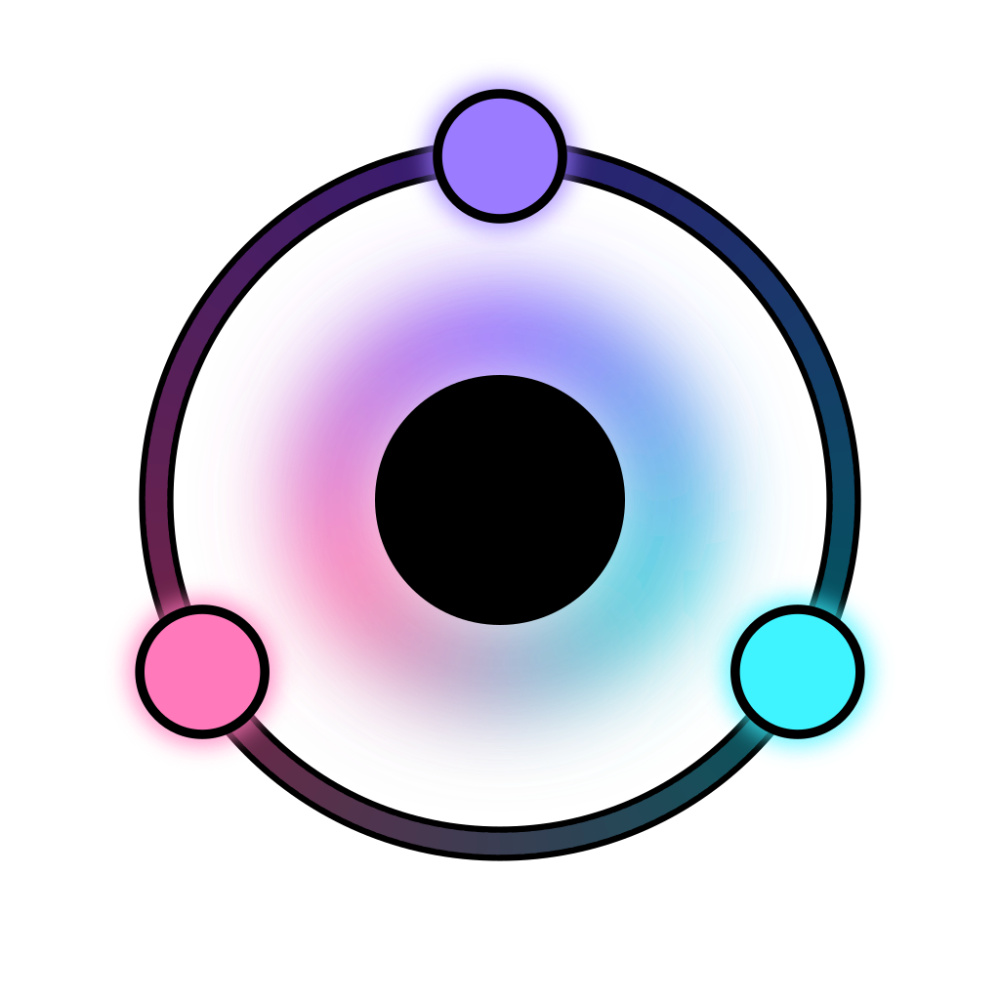
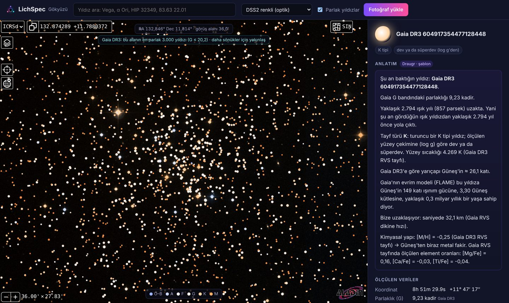
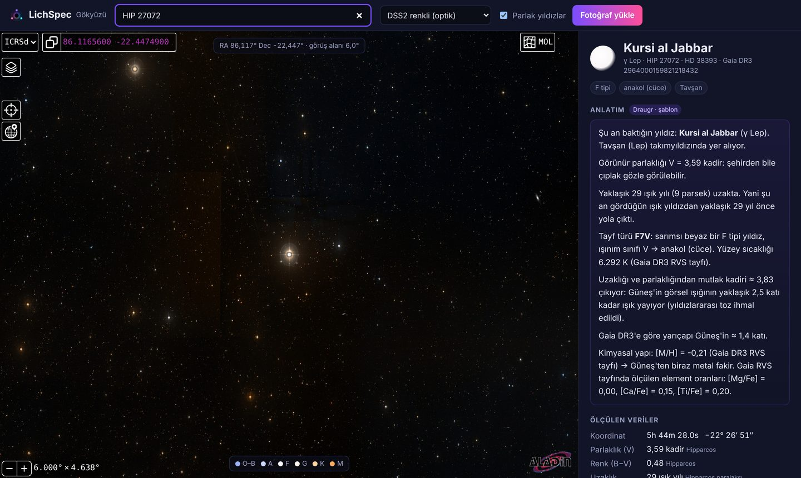
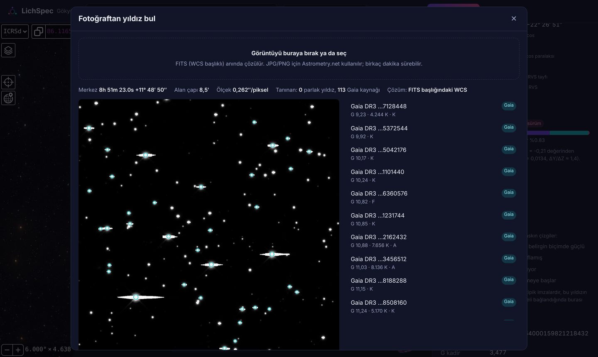

<p align="center">
  
</p>

<h1 align="center">LichSpec</h1>

<p align="center">
  AI system that identifies stars in space images (Phobetor), infers their composition from spectra (Poltergeist), and explains the results (Draugr).
</p>

<p align="center">
  <b><a href="https://ufuksagcan927-star.github.io/LichSpec/">Live sky explorer</a></b> ·
  <a href="web/README.md">Türkçe ayrıntılar</a> ·
  <a href="LICENSE">MIT licence</a>
</p>

---

## The sky explorer

A browser app for the whole sky: drag the globe around 360°, click any star and get a card built
from its measured data, or drop in a telescope image and see which stars are in it.

| | |
|---|---|
|  |  |
| **Whole sky.** 15,397 bright stars (Hipparcos V < 7) modelled offline with Gaia DR3 parameters and proper names; clickable and searchable. | **All 1.8 billion Gaia DR3 stars.** Zoom in and the brightest stars of the visible field stream in; the card shows temperature, gravity, chemistry, FLAME mass/age, radial velocity. |
|  |  |
| **Star card.** Every value names its source. Draugr (template version) narrates only what was measured; Poltergeist (preview) turns [M/H] into H/He/metal mass fractions. | **Photo → stars.** FITS images with a WCS header are solved in the browser (matches astropy to 1e-10″); stars are identified and marked on the photo. |

### How it works

- **Sky imagery** streams as HiPS tiles through [Aladin Lite v3](https://aladin.cds.unistra.fr/AladinLite/) (DSS2, Mellinger, Pan-STARRS, SDSS, 2MASS, AllWISE); nothing is embedded in the site.
- **Gaia DR3** comes straight from the browser: CDS's Gaia HiPS catalogue when it answers, otherwise one "brightest 3,000 in this field" query to a VizieR mirror (CDS, Harvard CfA or IDIA, whichever answers first). Field size on that path is capped by galactic latitude, because the query scans every star in the circle.
- **No server needed.** The site is static files (`web/`). An optional Flask server (`server/app.py`) adds a Gaia TAP proxy with ESA → Heidelberg failover and JPG/PNG plate solving through the Astrometry.net API.
- **FITS/WCS in JavaScript** (`web/js/fits.js`): TAN and SIN projections, CD / PC / CDELT+CROTA matrices, gzip, BSCALE/BZERO, asinh preview stretch.
- **Tested on the real internet.** [`site-check`](.github/workflows/site-check.yml) probes every data service (DNS, CORS, latency, column names), then opens the static site in Playwright and checks the sky, the Gaia layer, a star card and a FITS solve.

### Run it

```bash
cd web && python -m http.server 8080          # static, same as the hosted site
# or, with the optional server:
pip install -r server/requirements.txt && python server/app.py   # http://localhost:8000
```

Deployment: GitHub Pages (`.github/workflows/pages.yml`, Settings → Pages → Source: GitHub Actions) or Netlify (`netlify.toml`, publish folder `web`).

## The models

The name comes from the pulsar **Lich (PSR B1257+12)**, the first star found to host planets. Its three planets name the models:

| Model | Role | Status |
|---|---|---|
| **Phobetor** | Detects, segments and identifies stars in space images | Dataset and training code in progress on separate branches |
| **Poltergeist** | Predicts elements and compounds from a source's spectrum | Preview in the star card ([M/H] → composition, expected lines labelled "not measured") |
| **Draugr** | Explains the findings in plain language | Template narration from measured fields; LLM version planned |

## Data and credits

Gaia data © ESA/Gaia/DPAC (CC BY-SA 3.0 IGO); the Hipparcos Catalogue (ESA 1997); star names from d3-celestial (BSD-3-Clause); Aladin Lite, VizieR and HiPS by CDS, Strasbourg. Details and full notices: [THIRD_PARTY_NOTICES.md](THIRD_PARTY_NOTICES.md).

## Licence

Code: [MIT](LICENSE). The bundled star catalogue (`web/data/bright_stars.json`) contains Gaia DR3 values and is shared under CC BY-SA 3.0 IGO, as described in [THIRD_PARTY_NOTICES.md](THIRD_PARTY_NOTICES.md).
